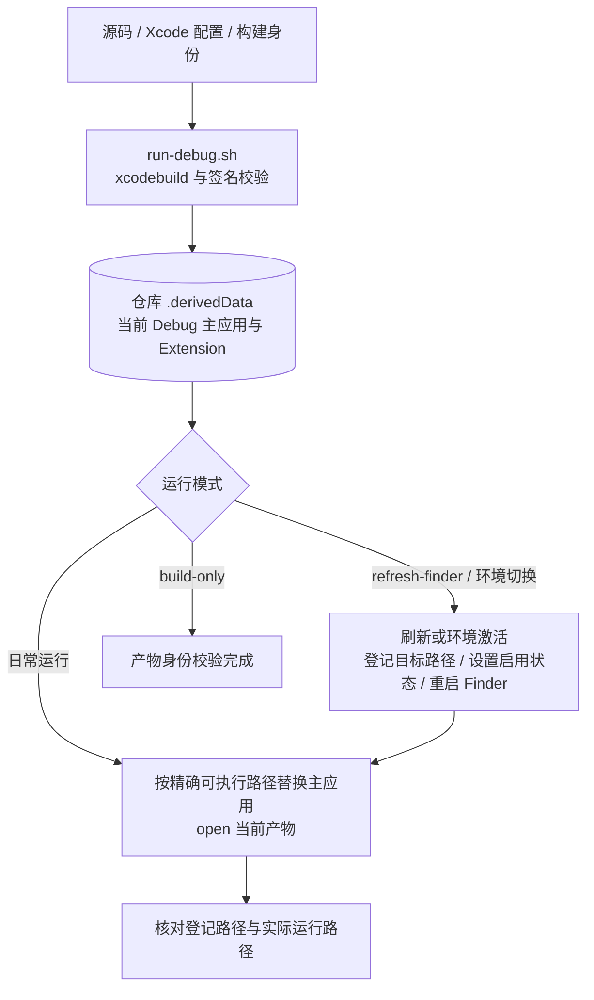
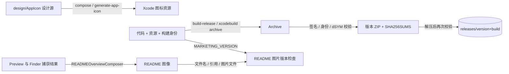

# 开发、验证与交付流程

开发工具与产品运行流程分开。此页按可独立理解的流水线概括 `scripts/`、专用测试宿主、预览和资源生成；完整参数与操作约束以 [scripts/Main.md](../../../scripts/Main.md) 为准。运行证据见[架构验证记录](../Architecture/Verification.md)。

## 构建、启动与环境切换

| 职责模块 | 核心脚本与源码入口 | 输入 | 外部 API / CLI | 输出 / 失败 |
|---|---|---|---|---|
| 构建与产品定位 | [run-debug.sh](../../../scripts/run-debug.sh) 编排构建，[product-paths.sh](../../../scripts/lib/product-paths.sh) 解析产物与身份，[code-signing.sh](../../../scripts/lib/code-signing.sh) 核对签名 | project、scheme、configuration、destination | `xcodebuild`、`plutil`、`codesign` | 签名产物及解析后的路径/身份；非零退出或身份不符终止 |
| 精确进程生命周期 | [process-lifecycle.sh](../../../scripts/lib/process-lifecycle.sh) 提供按可执行路径查询、停止与等待；[run-debug.sh](../../../scripts/run-debug.sh) 打开目标产物 | 产物可执行路径、当前 PID | 进程查询、`kill`、`open` | 旧路径进程结束、当前产物运行；超时失败 |
| Finder 环境 | [activate-environment.sh](../../../scripts/activate-environment.sh) 持有切换与恢复流程，[finder-environment.sh](../../../scripts/lib/finder-environment.sh) 适配登记和启用状态；Debug 刷新由 [run-debug.sh](../../../scripts/run-debug.sh) 编排 | 目标 Extension 路径、Debug/Release 身份 | `pluginkit`、Launch Services `lsregister`、用户级 `launchctl` | 登记/启用/运行分别核对；环境切换失败恢复原启用状态，已完成构建和登记不回滚 |
| 图标刷新 | [run-debug.sh](../../../scripts/run-debug.sh) 的 `--refresh-icon` 流程 | 当前 Debug 应用及缓存 | `lsregister`、IconServices/Dock 进程刷新 | 请求系统重新读取图标；不是产品业务接口 |

`--no-build` 使用已存在产物并重新核对身份；它与 `--build-only` 互斥。Debug 与 Release 数据及 IPC 身份隔离，两个 Finder Extension 的启用状态由环境脚本协调。

## 测试、预览与真实界面捕获

默认 `test.sh` 通过宿主调度一次性 macOS 虚拟机，源码同步、真实签名构建、桌面操作及外部结果核验均在 guest 执行。项目预热、临时签名、共用锁与清理协议由[虚拟机端到端测试](VirtualMachineTests.md)维护，用例入口见 [Tests](../../../Tests/Main.md)。

| 职责模块 | 核心入口 | 输入与外部 API | 输出与成功边界 |
|---|---|---|---|
| 宿主调度 | [test-vm.py](../../../scripts/test-vm.py)、[test-vm-guest.py](../../../scripts/test-vm-guest.py) | 当前源码、封存环境；Tart、SSH、内核文件锁 | 构建/测试/导出/清理独立状态与可重复输入；必要自动阶段全部通过，人工检查项独立记录 |
| 真实桌面 | [test-desktop-guest.sh](../../../scripts/test-desktop-guest.sh)、`Tests/FinderMenuCapture/Desktop/` | 实际设置控件、Finder 菜单；AX、CGEvent、SCK | 逐 case 步骤、断言、实际输出与失败截图 |
| IPC 集成 | [test-integration.sh](../../../scripts/test-integration.sh)、[ContextCommandSender.swift](../../../Tests/Integration/ContextCommandSender.swift) | 独立进程、真实签名及生产 socket | 配置读取及文件 flags；进程身份失败与主应用继续服务边界 |
| 单测例外与普通 CI | [test-checks.sh](../../../scripts/test-checks.sh) | 已确认的[故障模式](../../../Tests/UnitTestExceptions.md)、Xcode 构建与捕获定义 | 8 个竞态/系统故障例外、Preview 注册、静态定义；不代表真实用户流程 |
| Preview | [PreviewRuntime.swift](../../../Tests/ECMenuPreviews/PreviewRuntime.swift)、[capture-previews.sh](../../../scripts/capture-previews.sh) | 固定内存 Case 与生产呈现；guest 窗口就绪、截图 | 双语视觉证据；不是产品状态或文件输出验收 |
| Finder 菜单捕获 | [capture-finder-menus.sh](../../../scripts/capture-finder-menus.sh)、[FinderMenuAutomation.swift](../../../Tests/FinderMenuCapture/FinderMenuAutomation.swift) | 真实 Finder 上下文、语言和 fixture；AX、CGEvent、SCK | 标题检查与独立菜单 PNG，失败明确非零 |

开发工具权限只授予 guest 测试驱动，不进入生产产品依赖。手动构建启动与环境切换保留[焦点恢复](../UserFocusRestoration.md)，默认自动流程没有宿主桌面焦点或 Finder 窗口保持职责。

## 图标、README 图像与正式发布

| 职责模块 | 核心类型或脚本与源码入口 | 输入 | 外部 API / CLI | 输出 / 失败 |
|---|---|---|---|---|
| 图标资源生成 | [compose.sh](../../../design/AppIcon/compose.sh) 从设计源生成资源，[generate-app-icon.sh](../../../scripts/generate-app-icon.sh) 同步或比较正式资源 | SVG、Icon Composer JSON 模板 | `xmllint`、`jq`、Icon Composer `ictool --export-image`、文件差异比较；[图标源说明](../../../design/AppIcon/Main.md) | 正式资源；`--check` 比较一致性并以退出码反馈，不同步产品文件 |
| README 合成 | [capture-readme-images.sh](../../../scripts/capture-readme-images.sh) 协调捕获及更新，[READMEOverviewComposer.swift](../../../Tests/READMEImageCapture/Support/READMEOverviewComposer.swift) 持有图片排版和编码 | 已验证的设置页和 Finder 图片、Preview 产物版本 | CoreGraphics / ImageIO、`PlistBuddy` | 合成后的中英文版本化图像；全部成功后更新 README 图片与引用 |
| README 图片版本检查 | [check-readme-images.py](../../../scripts/check-readme-images.py)，由截图脚本和 [CI](../../../.github/workflows/ci.yml) 调用 | 工程 `MARKETING_VERSION`、README 引用与图片路径 | `plutil`、Python 文件读取 | 文件名版本、引用和非空图片文件一致；不一致则失败 |
| 发布编排 | [build-release.sh](../../../scripts/build-release.sh) | version/build、签名配置、项目 | `xcodebuild archive`、`codesign`、打包/解压、校验和工具 | Archive、ZIP、校验和；拒绝静默覆盖已有非空版本目录 |

正式交付路径、签名限制和身份值以[交付文档](../Delivery/Main.md)为准。当前发布脚本不执行网络发布。产品源、测试定义和持久文档都不依赖 scratch 产物；共享 Derived Data 或 Finder 登记状态的脚本必须顺序执行。

## 源码与资源边界

Xcode 的文件系统同步组随目录发现源码，`membershipExceptions` 明确排除 Preview 不拥有的应用装配和 Sender 不使用的 AppKit 绘制实现。预览复用能力的 Presentation 与 Settings 外壳；输入驱动、截图权限和固定 fixture 由 Tests 中的独立宿主拥有。目录调整需要同步这些成员关系及源码链接。
