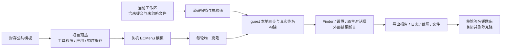

# 虚拟机端到端测试

测试桌面与开发桌面具有独立的 Finder、输入和应用状态。宿主封存公共工具模板，ECMenu 派生自己的项目模板，每轮从关机项目模板克隆并构建当前源码。入口和用例导航见 [Tests](../../../Tests/Main.md)。

完整验收使用 `./scripts/test.sh`；图片压缩专项使用 `python3 scripts/test-vm.py desktop --case image-compression`。`--case` 仅由 `desktop` 接受，省略时执行全部桌面 case；筛选通过宿主输入传入 guest 与桌面驱动，并记录于宿主及 guest 报告。专项复用同一克隆、构建、证据导出和清理边界。

## 执行流

| 所有者 | 入口 | 输入与输出 |
|---|---|---|
| 宿主调度 | [test-vm.py](../../../scripts/test-vm.py) | 公共及项目封存、当前源码、签名身份；生成输入归档、运行报告和 guest 证据 |
| guest 执行 | [test-vm-guest.py](../../../scripts/test-vm-guest.py) | SSH 标准输入协议、共享输入；引导 GUI 作业，再在其中同步、构建、验收、清理并导出 |
| 项目身份 | [Project.json](../../../Tests/Infrastructure/VirtualMachine/Project.json) | 可公开的稳定项目 ID |
| 本机执行配置 | [Local.example.json](../../../Tests/Infrastructure/VirtualMachine/Local.example.json) | 填写环境目录、模板、guest 目录和宿主应用来源；实际值保存在被 Git 忽略的同目录 `Local.json` |
| 公开应用设置 | [prepare-application-settings.py](../../../Tests/Infrastructure/VirtualMachine/prepare-application-settings.py) | VS Code 用户设置与系统语言地区；保存应用版本、设置及读回回执 |
| 应用启动准备 | [ExternalApplicationPreparation.swift](../../../Tests/EndToEnd/Desktop/Support/ExternalApplicationPreparation.swift) | 实际示例文本、文件夹与 iTerm 目录；系统打开请求、窗口证据、独立目标清单及本轮进程清理 |
| 外部窗口证据 | [ExternalApplicationWindows.swift](../../../Tests/EndToEnd/Desktop/Support/ExternalApplicationWindows.swift) | 模板准备和日常菜单请求后的应用身份；按 PID 捕获全部可见普通窗口及附属 sheet，导出 PNG 和窗口清单 |
| 原生驱动 | [FinderMenuAutomation.swift](../../../Tests/EndToEnd/Desktop/FinderMenuAutomation.swift) | Accessibility 控件、真实系统输入与截图；逐 case 报告及外部结果 |
| 权限准备 | [prepare-permissions.py](../../../Tests/Infrastructure/VirtualMachine/prepare-permissions.py) | 项目驱动路径和必要的管理员认证；通过系统设置准备驱动权限 |
| 实际录屏准备 | [CapturePermissionPreparation.swift](../../../Tests/EndToEnd/Desktop/Support/CapturePermissionPreparation.swift) | 捕获系统设置窗口；仅处理 Apple 签名进程中明确指向驱动的系统授权提示 |
| 桌面作业 | [run-desktop-job.py](../../../Tests/Infrastructure/VirtualMachine/run-desktop-job.py) | GUI launchd 独立启动原生驱动；透传输入输出、实际退出码、超时和作业清理 |
| 临时签名 | [SigningIdentity.swift](../../../Tests/Infrastructure/VirtualMachine/SigningIdentity.swift) | 精确项目 Team 的身份和随机密码；加密 P12、临时钥匙串及证书指纹 |

## 环境与缓存

本机执行位置由 `Tests/Infrastructure/VirtualMachine/Local.json` 唯一声明。公共配置位于所声明环境目录的 `environment.json`，项目封存位于其 `projects/ecmenu/environment.json`；模板名称和测试账户用户目录内的工作区相对路径也来自本机配置。填写格式见[项目适配](../../../Tests/Infrastructure/VirtualMachine/Main.md#本机配置)。模板必须关机，项目封存的 `baseSealedAt` 必须匹配公共封存。

准备阶段始终从关机公共模板全新建立候选，安装本轮完整 VS Code 与 iTerm 应用 bundle，应用声明式公开设置，构建产品与原生驱动，再通过真实系统设置准备驱动的辅助功能和录屏授权。Appium Mac2 仅承担这一权限准备，日常产品流程由原生 Swift 驱动执行。候选完成来宾操作系统关机后事务替换本项目模板及封存记录，候选准备失败保留原项目模板，公共模板保持封存。日常运行从项目模板克隆，使用已经准备好的应用、权限及缓存。

项目模板的测试账户采用常规英文系统配置：`AppleLocale` 为 `en_US`，`AppleLanguages` 为 `en-US`。VS Code 的用户 `settings.json` 和 iTerm 的普通偏好保存下列公开选项，环境准备使用正常应用配置，不写第三方应用私有状态。[设置准备](../../../Tests/Infrastructure/VirtualMachine/prepare-application-settings.py)在候选中写入声明式配置并读回核对，文件读取或结构错误时明确失败，保存版本、设置和系统地区回执。

| 配置位置 | 用户设置 | 值 | 环境准备目的 |
|---|---|---|---|
| VS Code 用户设置 | `workbench.welcomePage.experimentalOnboarding` | `false` | 关闭该版本的实验性首次引导 |
| VS Code 用户设置 | `workbench.startupEditor` | `none` | 不创建默认启动编辑器 |
| VS Code 用户设置 | `window.restoreWindows` | `none` | 启动时不恢复模板准备中打开的旧窗口 |
| VS Code 用户设置 | `security.workspace.trust.untrustedFiles` | `newWindow` | 在独立受限窗口打开未信任文件，保持工作区信任机制 |
| iTerm `com.googlecode.iterm2` 偏好 | `SUEnableAutomaticChecks` | `false` | 关闭自动更新检查 |

未信任文件选项来自 [VS Code 工作区信任说明](https://code.visualstudio.com/docs/editing/workspaces/workspace-trust#opening-untrusted-files)；更新检查键由 [iTerm 官方偏好 API](https://iterm2.com/python-api/preferences.html#iterm2.preferences.PreferenceKey.SOFTWARE_UPDATE_ENABLE_AUTOMATIC_CHECKS)公开。项目应用版本由宿主应用 bundle 同步和 `prepare-test-vm.sh` 刷新，实际版本随准备与运行报告保存。

VS Code 的启动与窗口选项在宿主实际 1.141.0 设置注册表中核对，其中 `experimentalOnboarding` 标记为实验性；本项目只记录该版本的使用依据。应用更新后重新检查设置及普通启动截图，项目封存与运行报告记录实际应用版本。[启动准备](../../../Tests/EndToEnd/Desktop/Support/ExternalApplicationPreparation.swift)实际打开示例文本、文件夹和 iTerm 目录，保存 `startup-targets.json`、所有可见普通窗口及附属 sheet 证据，清理本轮应用进程后再封存。清理统一发送 `SIGTERM` 并等待至多十秒，超时使准备失败；该边界是进程资源收尾，不作为第三方应用退出界面的验收。此检查确认工具环境可启动，实际 ECMenu 外部应用流程仍记录为待人工检查。

模板清理由 guest 引导层在协调桌面作业退出后完成。GUI 协调者负责移除临时签名、恢复钥匙串搜索列表并导出运行证据；引导层等待作业注销及输入 FIFO 清理，再补齐最终作业日志和退出码。只有证据复制完成且准备成功后，才清空候选模板的 `.artifacts/scratch/`。

封存前由宿主通过已有私有管理员认证发起来宾 `/sbin/shutdown -h +5s`，标准输入传递密码，延后五秒使 SSH 请求先返回。宿主等待至多 120 秒，只有虚拟机运行进程正常退出且退出码为 0，才进入事务封存；关机超时、失败或中断均使候选准备失败。文件系统及系统偏好状态的提交由来宾正常关机拥有。

日常克隆启动后，在引导及输入同步前执行 `template-clean` 阶段，要求 guest 项目 `.artifacts/scratch/` 不存在。残留会直接使本轮失败，避免把模板内旧证据复制为当前结果；当前运行的 scratch 由后续引导层创建。

平台边界（Tart 2.40.1、来宾 macOS 26.6.2）：已核对的 [Tart 实现](https://github.com/cirruslabs/tart/blob/2.40.1/Sources/tart/VM.swift#L251-L290)在取消运行时调用 `VZVirtualMachine.stop()`；该调用边界没有发起来宾操作系统关机。Apple 公开 `shutdown` 源码接受[秒偏移](https://github.com/apple-oss-distributions/system_cmds/blob/main/shutdown/shutdown.c#L554-L592)，并在非零偏移时 [fork 后由父进程退出 0](https://github.com/apple-oss-distributions/system_cmds/blob/main/shutdown/shutdown.c#L289-L311)，因此 SSH 成功只确认关机请求已提交。项目观察到，引导层删除 scratch 后，后续克隆仍带有旧准备产物与 `running` 报告；未提交状态丢失是符合证据的推断，确切根因尚未证明。正常系统关机作为封存边界，日常克隆的缺席检查验证实际持久化的空证据基线。

应用安装的项目观察：2026-10-11 在 macOS 26.6.2 来宾中，`ditto` 覆盖已使用的 VS Code bundle `Contents` 时返回大量 `Operation not permitted`，运行标识为 `20261011-070113-vm-prepare-86035`。宿主来源的文件标志、权限和 ACL 检查未发现拒绝项，归档中抽检文件字节与来源一致；这些宿主证据没有说明来宾拒绝的确切原因。Apple 将更新或删除其他应用纳入 [App Management 权限](https://support.apple.com/guide/mac-help/change-privacy-security-settings-on-mac-mchl211c911f/mac)。该权限边界是项目推断，缺少来宾 TCC 日志，尚未确认因果；当前安装边界是在全新公共基线候选中安装完整应用。

模板准备和图形验收在产品流程前实际捕获系统设置窗口，并核对系统录屏提示。macOS 26.6.2 的项目观察是：录屏预检返回 `true` 后，实际捕获仍可能弹出要求绕过系统窗口选择器的授权提示；当前按钮为 `Allow`，本项目不据此推断授权持续时间。原生准备只匹配 Apple 签名进程中明确命名 `FinderMenuAutomation` 的提示，显式允许按钮必须唯一，未知提示直接失败。保存实际 PNG 与授权结果后关闭系统设置，再进入产品验收。

guest 的执行协调器和桌面驱动通过测试账户的 GUI launchd 独立启动。SSH 引导只校验公开输入、解出当前源码中的作业启动器，并透传标准输入；签名导入、构建与产品验收在 GUI 会话中执行。macOS 26.6.2 上观察到，从 SSH 直接启动驱动时辅助功能请求归属 SSH 服务；独立作业的请求归属 `FinderMenuAutomation`。权限准备与日常调用使用同一启动边界，Preview 也由该驱动通过 ScreenCaptureKit 捕获指定窗口。作业记录原始退出码、日志和超时，结束时移除 launchd 作业与输入 FIFO。源码导航见[项目适配](../../../Tests/Infrastructure/VirtualMachine/Main.md)。

运行克隆隐藏图形窗口，关闭宿主剪贴板、音频及 USB 传入。SSH 使用专用密钥、严格主机校验与公共模板 HostKeyAlias；启动就绪同时要求 SSH 可用、测试账户位于 `/dev/console`、Dock 已运行。

源码归档读取当前 Git 跟踪文件及未忽略的新文件，包括未提交修改并排除已删除文件与本机 `Local.json`。输入在 guest 仓库内解包，再同步到所配置的工作区；`.derivedData/` 与项目权限准备的 `node_modules/` 缓存保留，每轮仍执行当前代码构建。临时运行新增缓存随克隆删除；普通源码改动无需重新预热，工具或公共封存变化时重新准备，构建耗时明显增加时可主动刷新缓存。

## 凭据与签名

管理员密码从公共私有 `credentials.json` 读取，核对账户、所有者与权限，只在已授权的 guest 管理员操作需要时通过标准输入传入认证流程。SSH 不使用密码认证。凭据不进入源码归档、共享输入、日志或结果。

开发签名保持项目现有 Team、产品身份和 App Group。宿主只导出精确项目 Team 的单个有效 Apple Development 身份，导出时使用随机 P12 包装密码；显式 P12 来源使用宿主项目私有配置中的解密密码。每轮 guest 钥匙串使用独立随机密码，在仓库 scratch 创建并配置签名工具访问，随后使用手动签名构建；结束后移除钥匙串，项目模板不封存私钥。

本轮用户钥匙串搜索列表仅包含临时签名钥匙串，构建配置使用验证后的证书 SHA-1 作为精确签名身份，并显式指定该钥匙串。协调器保存原搜索列表，清理时恢复；默认钥匙串不变。GUI 执行上下文、受控搜索列表和精确身份组合已在预热克隆中完成真实签名构建。Apple 将执行上下文、钥匙串解锁及访问控制列为 `errSecInternalComponent` 的调查边界，见 [DTS 签名诊断](https://developer.apple.com/forums/thread/712005)；本项目证据只验证上述组合，不将某一项单独推断为所有失败的原因。

钥匙串沿用系统的空闲锁定策略，guest 在各构建或验收阶段开始前通过标准输入提供本轮密码并显式解锁。完整验收分别调度 Finder、桌面产品流程、IPC 和少量故障注入检查，使长时间桌面操作后重新构建时仍具有明确的解锁边界。

宿主同时传递经系统代码签名策略验证的公开证书链。guest 在内存中核对身份、私钥和完整链，再向单轮钥匙串补齐公开证书；系统继续拥有信任锚与信任设置，不添加自定义信任。仅传递宿主导出的 P12 时，当前公共基线缺少所需中间证书，无法完成离线信任校验。

显式 P12 来源配置位于本机环境目录的 `projects/ecmenu/signing.json`，包含 `version: 1`、绝对 `p12Path`、非空 `p12Password`。私有目录权限 `0700`，配置及 P12 权限 `0600`，所有者必须为当前宿主账户。没有此配置时尝试无交互导出；钥匙串拒绝导出时明确失败，不能以 ad-hoc 签名替代生产 IPC 验收。

首次签名来源初始化使用 `python3 scripts/prepare-test-signing.py`。它复用已有的精确项目 Team 身份，允许本次宿主钥匙串系统授权，导出后以内存检查核对有效证书、私钥签名及证书指纹。成功后将加密 P12 和随机解密密码分别保存为宿主项目私有 `development-identity.p12` 与 `signing.json`；现有配置只验证，不覆盖。初始化共用测试锁，产物报告只含状态、Team 与公开指纹。日常导出、检查和 guest 导入仍禁止交互。

SDK 允许 `SecItemExport` 导出指定 `SecIdentity` 为 PKCS#12；导入参数的 `accessRef` 指定私钥初始 ACL。[Apple API](https://developer.apple.com/documentation/security/secitemimportexportkeyparameters/accessref) 初始 partition ACL 的描述编码参考 [Apple Security 源码](https://github.com/apple-oss-distributions/Security/blob/main/SecurityTool/macOS/keychain_find.c)；该配置是否满足当前 guest 无人值守签名必须由真实构建证据确认。

## 结果与失败

宿主共用内核 `run.lock` 覆盖模板准备、克隆、测试、导出及清理，多个项目排队，控制进程退出自动释放。所有宿主证据位于 `.artifacts/scratch/tests/YYYYMMDD-HHMMSS-vm-<action>-<pid>/`；guest 证据按 `guest-artifacts/{tests,logs,previews,probes}/` 导出。

`vm-report.json` 记录源码 SHA-256、公共环境、模板、阶段耗时和清理；`guest-report.json` 区分任务、导出与签名清理；桌面 `report.json` 记录用户步骤和独立断言。外部应用 case 的 `manualReview` 保存 `instructions` 与 `evidence`，case 和桌面顶层使用 `review-pending`。guest 与宿主传递 `manualReviews`，相应阶段及顶层继续显示 `review-pending`；必要自动阶段、导出与清理成功时退出 0，人工结果仍独立待确认。

构建完成后，Finder、桌面产品、IPC 和边界检查分别记录结果；一个验收阶段失败后继续收集其他独立阶段的证据，中断请求立即停止后续阶段。失败也导出已有现场，保留原始原因及清理失败，任一必要自动阶段、导出或清理失败整轮非零退出。清理只针对本轮创建的克隆；公共模板和其他项目模板保留。

## 验证边界

当前公共基线记录 macOS 26.6.2、Xcode 27.0，桌面流程验证 Debug 实际产品和同 Team 的原生驱动。小功能按影响范围选择对应用户流程，大修改与发布前运行完整验收。8 个既有单测只覆盖难以稳定触发的竞态和系统 API 故障，理由见[例外清单](../../../Tests/Unit/Exceptions.md)。`./scripts/test-checks.sh` 在开发机上调度 VM `checks`，在普通 CI 中使用自己的 runner。此任务只同步源码、验证工具、准备临时签名并执行构建及应用承载的 XCTest，测试窗口留在来宾；无需录屏权限准备或系统设置。Preview 的 `--list` 在创建 AppKit 应用前返回。构建检查不代表完整桌面验收。

截图属于可检查的外观证据，没有图像断言。外部应用流程自动检查真实菜单、应用启动与可见窗口，并记录应用版本、独立目标清单及应用全部可见窗口的截图；文件或项目是否加载、iTerm2 工作目录是否正确由人工检查。驱动边界是 ECMenu 菜单操作与系统应用窗口。固定文本输入不证明真实输入法候选行为；项目首轮接入成功证据必须包含当前源码构建、真实操作、结果导出和克隆删除。模板预热成功单独表达，不作为功能通过。

本阶段未纳入干净安装、首次产品权限、真实注销登录、最低支持系统及 Release 交付物的完整验收。公共基线的授权不能证明这些系统边界。

## 接入证据

2026-10-11 的接入检查使用上述公共基线。一次性宿主签名来源初始化、guest 证书链验证、真实签名构建和项目模板封存已通过。默认完整流程的必要自动阶段、结果导出和清理已经完成，整体状态为 `review-pending`；外部应用人工检查尚未完成。

| 检查 | 结果与限制 |
|---|---|
| 签名来源 | 精确项目 Team 的单个 Apple Development 身份已导出、内存验证并保存到宿主私有配置；日常运行复用此来源。 |
| 来宾签名 | 公开证书链与私钥验证通过，单轮钥匙串导入成功；主应用、Finder Extension、原生驱动、Preview 和 IPC sender 的真实开发签名构建通过。 |
| 管理员认证与桌面作业 | 真实系统认证完成；输入输出透传、退出码 7、超时 124 与作业清理已验证。认证活动产物结束后删除。 |
| 驱动权限与模板 | 从公共基线全新派生，完整目标应用安装、公开设置读回、真实签名构建和工具权限准备通过；辅助功能与录屏均为 `true`，实际应用启动窗口已导出，私钥移除通过。 |
| 模板持久化边界 | 来宾正常关机、VM 进程退出 0、事务封存与宿主清理通过；随后日常项目克隆的 `template-clean` 检查通过，确认引导前项目 scratch 不存在，模板已持久化空证据基线。 |
| 保留 XCTest | `.xcresult` 确认 8 项执行通过，失败与跳过均为 0；设备模型为 Virtual Machine，macOS 26.6.2、arm64。 |
| 双语 Finder 菜单 | 中英文各五类场景完成实际选择、标题检查与截图，场景及语言边界的 Finder 窗口清理通过。 |
| 签名 IPC | 9 项场景通过：正常查询、错误签名身份拒绝、协议错误、帧边界、断连、超时及实际隐藏文件；故障后同一主进程仍响应认证查询。 |
| 产品桌面自动检查 | 当前模板克隆中八组通过：模板导入/编辑/重启、新建文件字节与冲突、模板替换/删除、复制路径与显隐、图片压缩、菜单配置与会话、不可写目标反馈、模板库失败恢复与空状态；本轮退出 0，导出与清理通过。 |
| 外部应用证据 | 一组为 `review-pending`：真实菜单、应用进程和可见窗口自动检查完成，保存版本、目标清单及截图；文件或项目加载和终端工作目录待人工确认。 |
| 双语 Preview | 全部 12 个场景的 24 张 PNG 已生成、导出并完成清理；人工抽查四张未发现布局问题，其余可见结果仍按截图检查。 |
| README 图片 | 真实设置页准备 TXT、Markdown，默认文件名与双语 Finder 两行模板检查通过；两张 3560 × 2848 概览已同步，版本引用检查通过。两图人工查看未发现布局裁切，生成、导出与克隆清理通过。 |
| 完整流程 | Finder、桌面、IPC、保留 XCTest 及导出/清理完成，退出 0；整体 `review-pending` 保留人工验收边界。 |
| 环境收尾 | 完整流程克隆已关闭、删除，凭据清理与结果导出通过；公共和其他项目模板保持关机。 |

当前全新模板准备证据为 `20261011-072446-vm-prepare-91453`，当前模板的桌面流程与空证据基线检查为 `20261011-073034-vm-desktop-92596`。双语 Preview 为 `20261011-065806-vm-previews-84977`，README 图片为 `20261011-075928-vm-readme-2361`。完整流程证据为 `20261011-064848-vm-run-82413`，XCTest 官方结果摘要为 `20261011-065558-xctest-summary-84587`。签名初始化和桌面作业机制证据分别为 `20261011-033613-signing-setup-53155`、`20261011-031713-vm-bootstrap-31448`（UTC 命名）。可重建证据位于仓库 scratch；本节保留结论与适用限制，不依赖临时产物继续存在。

目录与配置整理的针对性构建证据为 `20261011-075004-vm-checks-98757`：实际 `.xcresult` 确认 8 项通过、失败与跳过均为 0，12 项 Preview 注册列举和捕获定义检查通过，导出及清理通过。当前 README 专项使用上述图片证据，双语菜单均只包含 TXT、Markdown；子菜单 AX 快照与实际窗口的联合就绪边界见[菜单捕获](../FinderMenuCapture.md#稳定协议)。各记录只覆盖对应运行的源码与场景。
