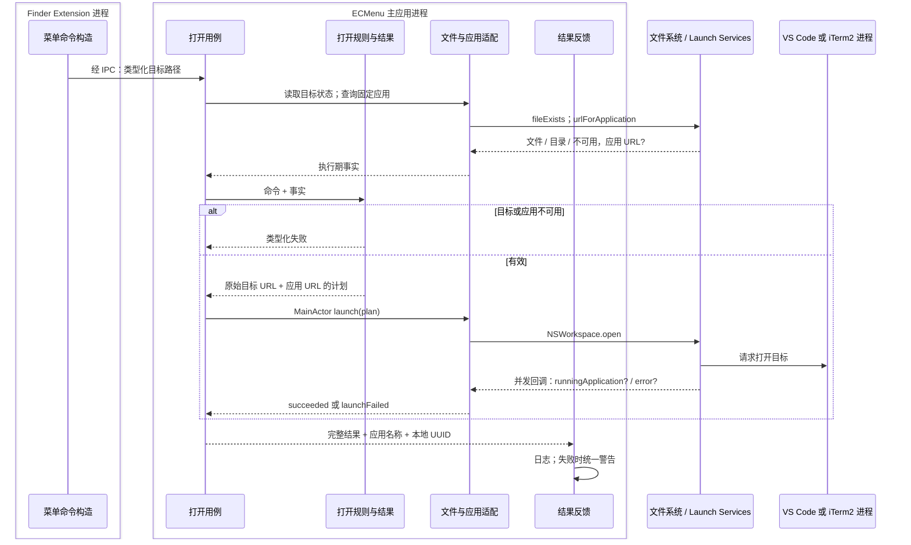

# 进入外部应用

能力范围是把一个 Finder 原始目标交给固定的 VS Code 或 iTerm2 应用。命令类型分别声明目标种类和应用身份。产品行为见[需求](../../Requirements/Features/OpenInApplications.md)，Finder 场景解释见[菜单语义](../Platform/Finder/ContextMenus.md)。

## 执行流

成功表示系统打开请求成功回调；不表示编辑器已完成项目加载或终端已完成工作目录切换。`NSWorkspace` 是进程内 SDK 适配，实际打开请求交给系统服务与外部应用。

## 模块、输入输出与状态

| 职责模块 | 核心类型 | 源码入口 | 输入 → 输出 | 状态 / 外部调用 |
|---|---|---|---|---|
| 菜单命令构造 | `OpenInApplicationFeature<Command>` | [OpenInApplicationFeatures.swift](../../../ECMenuFinderExtension/Commands/OpenInApplication/OpenInApplicationFeatures.swift) | 单个目标事实 → 专用 Command? | 纯条件；上下文读取与应用查询由菜单公共边界提供 |
| 打开规则与结果 | `OpenInApplicationRules`、`OpenInApplicationPlan`、`OpenInApplicationOutcome` | [OpenInApplicationRules.swift](../../../ECMenu/Commands/OpenInApplication/Domain/OpenInApplicationRules.swift) | 命令 + 目标状态 + 应用 URL? → Plan / Failure | 无 I/O；iTerm2 只接受目录，VS Code 接受存在的文件或目录 |
| 打开用例 | `OpenInApplicationHandler<Command>`、`OpenInApplicationExecution` | [OpenInApplicationHandlers.swift](../../../ECMenu/Commands/OpenInApplication/Application/OpenInApplicationHandlers.swift)、[OpenInApplicationExecution.swift](../../../ECMenu/Commands/OpenInApplication/Application/OpenInApplicationExecution.swift) | 命令、注入平台 → Outcome | 单次调用保存不可变事实/计划；等待系统回调，不保存另一份应用状态 |
| 文件与应用适配 | `OpenInApplicationPlatform` | [接口声明](../../../ECMenu/Commands/OpenInApplication/Application/OpenInApplicationExecution.swift)、[系统实现](../../../ECMenu/Commands/OpenInApplication/Platform/OpenInApplicationSystem.swift) | 路径、应用声明、计划 → 事实 / 打开结果 | FileManager、NSWorkspace 和 continuation；实际输入输出见下表 |
| 结果反馈 | `OpenInApplicationAlertContent`、`OpenInApplicationFeedback` | [OpenInApplicationAlertContent.swift](../../../ECMenu/Commands/OpenInApplication/Presentation/OpenInApplicationAlertContent.swift)、[OpenInApplicationFeedback.swift](../../../ECMenu/Commands/OpenInApplication/Presentation/OpenInApplicationFeedback.swift) | Outcome、应用名、UUID → 固定失败说明 / 日志 | 纯文案与 `NSAlert`、`Logger`；成功不增加反馈窗口 |

没有业务持久化状态。Extension 与主应用各自查询应用可定位性，应用安装/移动/删除可以发生在菜单和执行之间；执行必须重新查询。

## API 契约与能力边界

| API | 实际输入 → 输出 | 失败与消费方式 |
|---|---|---|
| `FileManager.fileExists(atPath:isDirectory:)` | 绝对路径与 Bool 输出指针 → exists、isDirectory | 跟随符号链接检查最终对象，断链不可用；执行仍保留原始 URL |
| `NSWorkspace.urlForApplication(withBundleIdentifier:)` | 命令声明的固定 bundle ID → URL? | nil 表示无法定位应用；不依赖显示名称或 PATH |
| [`NSWorkspace.open(_:withApplicationAt:configuration:completionHandler:)`](https://developer.apple.com/documentation/appkit/nsworkspace/open%28_%3Awithapplicationat%3Aconfiguration%3Acompletionhandler%3A%29) | 单元素目标 URL 数组、应用 URL、默认 OpenConfiguration → 异步回调 | 本项目在 MainActor 发起；SDK 回调在并发队列。error 冻结为 launchFailed，无 error 为 succeeded；不使用回调的应用对象 |
| `withCheckedContinuation` | 一次系统完成回调 → Outcome | 等待该次打开请求；Task 取消不能撤回已经提交的系统打开请求，Router 可跳过后续反馈 |
| `NSAlert` / `Logger` | 失败、应用名、UUID → 警告和诊断 | 诊断保留目标与系统错误；用户说明保持命令级语义 |

macOS 26.5 SDK `NSWorkspace.h` 明确异步打开回调的队列和成功/失败参数。调用使用 Launch Services，不构造 shell 或 CLI 字符串。package 按文件系统目录事实处理，没有额外读取 Finder package 标记。

## 验证与实机证据

[虚拟机日常验收](../../../Tests/Main.md)在来宾安装实际 VS Code 与 iTerm2，从真实 Finder 菜单触发打开请求，检查命令适用范围、应用启动与可见窗口，并保存独立目标清单、应用版本和各应用全部可见窗口截图。定义见[外部应用验收](../../../Tests/EndToEnd/Desktop/Acceptance/DesktopExternalApplicationsAcceptance.swift)。

外部应用安装、公开启动选项和一次性常规启动检查由项目模板准备拥有，版本适用范围见[环境与缓存](../Delivery/VirtualMachineTests.md#环境与缓存)。日常产品流程直接使用已准备应用，从真实 ECMenu 菜单触发请求。

[ExternalApplicationWindows](../../../Tests/EndToEnd/Desktop/Support/ExternalApplicationWindows.swift)等待实际应用进程和 ScreenCaptureKit 中属于该 PID 的屏幕可见普通窗口（`windowLayer == 0`），为普通窗口绘制留出两秒后重新枚举，逐窗保存包含附属 sheet 的 PNG，并记录窗口编号、标题与图片路径清单。绘制等待不作为目标加载完成的断言。标题作为检查材料，不参与目标匹配；请求目录与文件由独立目标清单保存，人工据此对照真实内容。截图保留应用的首次引导和权限提示，驱动不操作这些界面。

外部应用目标加载、窗口复用和终端工作目录由人工检查；报告使用 `review-pending`，由 `manualReview` 保存检查说明与证据。截图保留第三方应用当时的可见状态，包括可能出现的首次引导；驱动的边界是 ECMenu 菜单操作与系统应用窗口，避免依赖第三方应用内部控件、文案和快捷命令协议。

项目验收证据（2026-10-11，macOS 26.6.2、VS Code 1.141.0、iTerm2 3.7.4，运行标识 `20261011-073034-vm-desktop-92596`）：独立目标清单记录文本 `ECMenu-open-target.txt`、项目目录 `ECMenu-project-folder` 和终端目录 `external-app-target`。真实菜单适用范围、打开请求和可见窗口检查完成，截图与目标清单成功导出。人工观察到当次 Code 截图显示预期正文与项目目录，iTerm 提示符显示目标目录 basename；完整终端工作目录尚未复核，报告继续为 `review-pending`，截图观察不作为自动目标加载断言。

实机复验记录 macOS、VS Code 与 iTerm2 版本，以普通目录、package 和符号链接分别执行，观察目标内容与实际工作目录。现有技术记录没有完整的外部应用版本矩阵；系统打开回调与窗口截图不构成目标已加载的自动证明。
